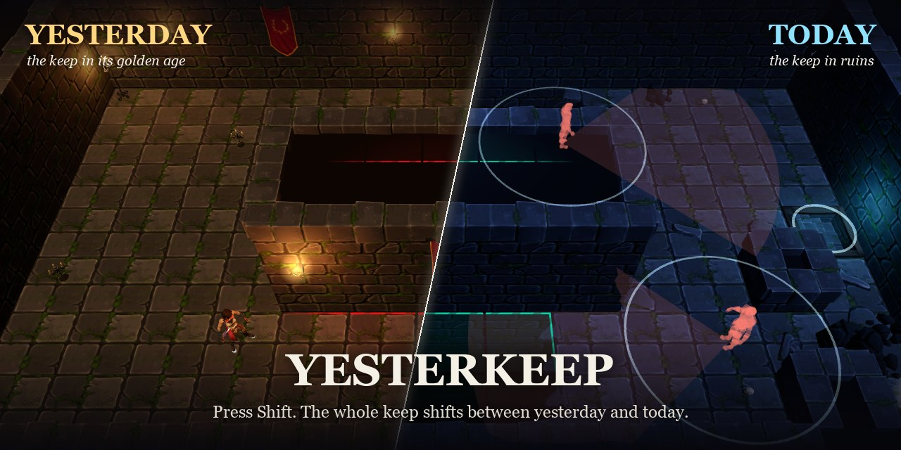
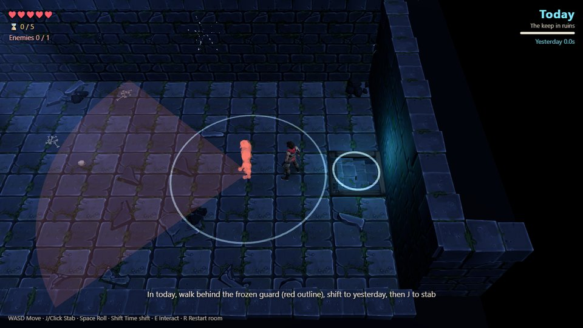
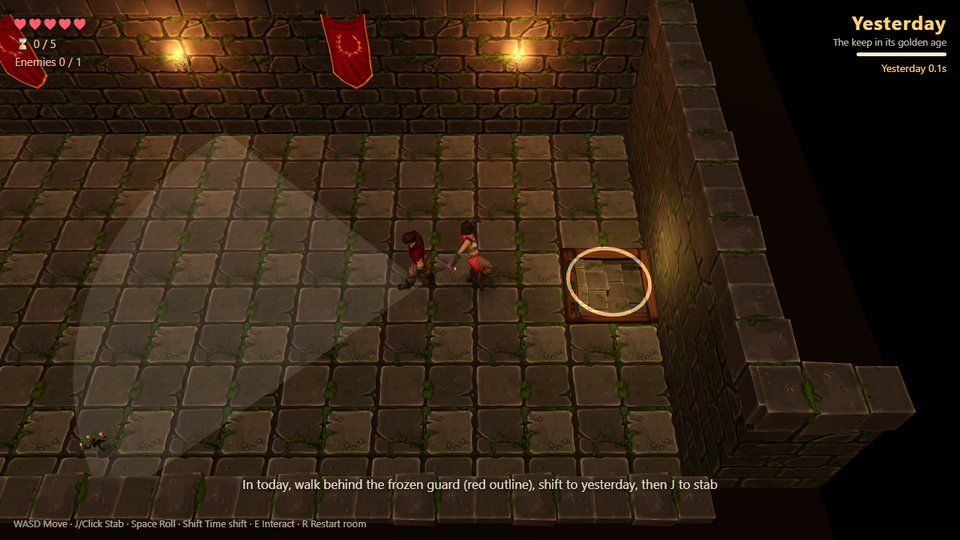
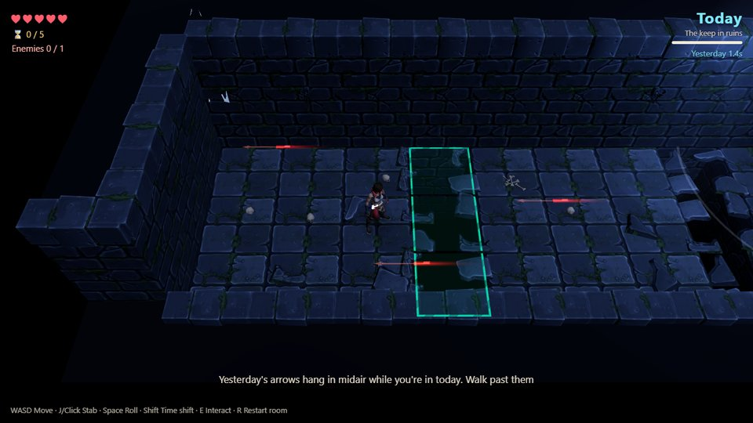
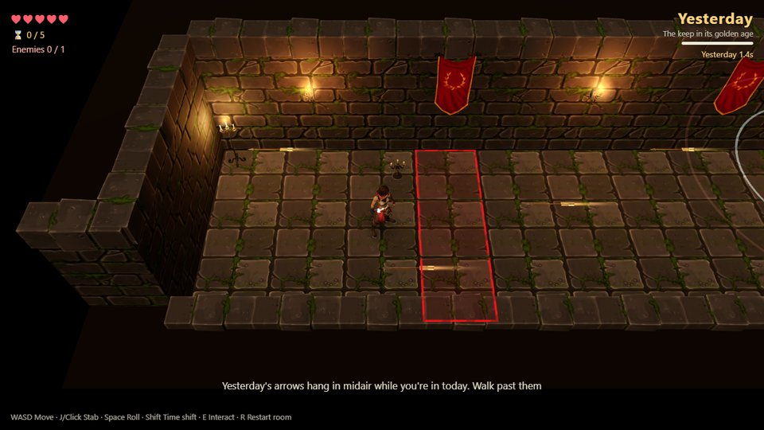
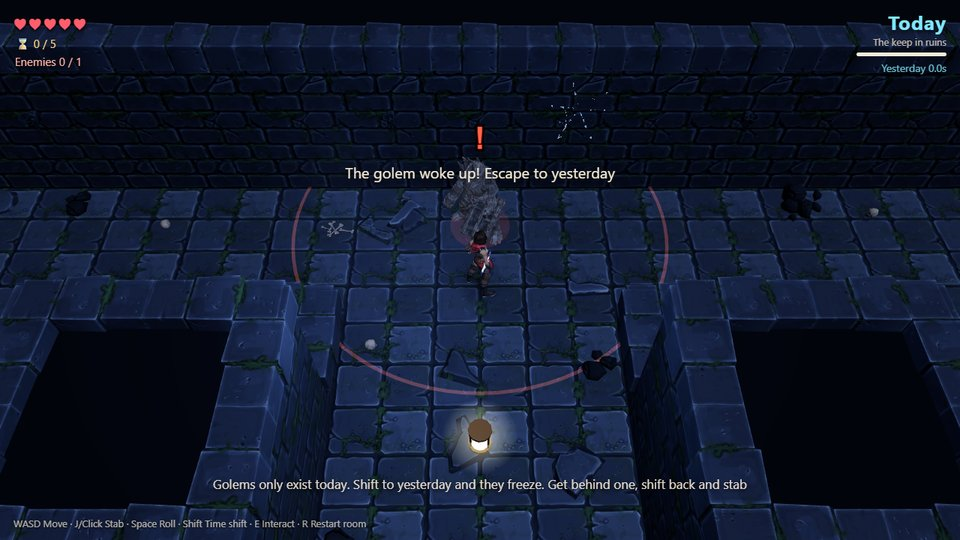

<p align="center">
  
</p>

<h1 align="center">Yesterkeep <sub>어제의 성채</sub></h1>

<p align="center">
  A stealth dagger game about one key.<br>
  <b>GitHub Game Off 2026</b> · theme <b>SHIFT</b> · plays in the browser · three.js
</p>

---

Press **Shift** and the whole keep shifts between its golden past (**yesterday**) and its ruined present (**today**).
Guards only exist yesterday; today they stand frozen as red ghosts. The era you leave freezes in place,
so you can hold a gate open, stop arrows mid-air, or slip behind a guard and strike from the other side of time.

## One key, two keeps

| Today | Yesterday |
|---|---|
|  |  |
| The guard is frozen. Walk around behind it. | Shift back. It never saw you coming. |
|  |  |
| Yesterday's arrows hang in midair while you are in today. | Step back into yesterday and they fly again. |



Stone golems exist only today. Stab one from the front and it bounces off the shield, then the hammer comes down.
Shift to yesterday, where the golem freezes, get behind it, and shift back.

**Score** = seconds spent in yesterday. Fewer seconds, fewer alarms, more stars.

Built with plain JavaScript and [three.js](https://threejs.org/). No build step, no framework.

## Controls

| Key | Action |
|---|---|
| WASD | Move |
| J / Click | Stab |
| Space | Roll |
| Shift | Shift era (yesterday ↔ today) |
| E | Interact |
| R | Restart room |

## Running locally

The game uses ES modules, so it must be served over HTTP (opening `index.html` directly will not work).

```bash
python -m http.server 8133
```

Then open <http://localhost:8133>.

**The 3D art is not in this repository** (see below). Without it the game will not load its models.

## Third-party assets not included

The art and animation come from paid packs on [Fab](https://www.fab.com/) under the Fab Standard License,
which does not allow redistributing the source files. They are excluded with `.gitignore`.
To run the game from source, buy the packs yourself, convert them to GLB, and place them under `assets/fab/`:

| Pack | Used for | Path in `assets/fab/` |
|---|---|---|
| FANTASTIC Dungeon Pack | Floors, walls, stairs, traps, levers, gates, props | `Fantastic_Dungeon_Pack/meshes/`, `Fantastic_Dungeon_Pack/textures/` |
| Modular Stylized Character (Polyart) | Player (rogue) and guards | `Polyart/ModularStylizedChars/` |
| Dagger Animation Pack | Dagger model and player/guard animations | `Dagger/Demo/Characters/Mannequins/Meshes/Dagger.glb`, `anims/Dagger.anims.glb`, `anims/SKEL_Mannequin.anims.glb` |
| Armored Stone Golem | Stone golem enemy, hammer and shield | `StoneGolem/`, `anims/SKEL_StoneGolem.anims.glb` |

`tools/golem_pack.py` and `tools/shrink_tex.py` show how the GLB files were trimmed and compressed for the web.
`tools/readme_shots.py` renders the screenshots on this page with headless Chrome, and `tools/readme_compose.py` builds the banner.

## Repository layout

| Path | Contents |
|---|---|
| `index.html` | Page, HUD, import map |
| `src/` | Game code (`main.js`, `rooms.js`, `hero.js`, `golem.js`, `eramat.js`); `src/dev/` holds dev-only test tools |
| `lang/` | UI translations (Korean is the source text) |
| `vendor/` | three.js (MIT, see `vendor/three-LICENSE.txt`) |
| `tools/` | Asset preparation scripts |
| `docs/` | Progress screenshots; `docs/readme/` holds the images on this page |
| `devlog/` | Devlog notes and video scripts |
| `DESIGN.md`, `NOTES.md` | Design document and technical notes (Korean) |

## AI disclosure

This game was made with help from AI coding tools (Claude Code).

## License

Code © 2026 xmflrtm2. All rights reserved (no open-source license yet).
three.js is MIT-licensed. Fab assets belong to their creators and are not part of this repository.
